# SBT-DF205 — Case 1: Android Forensics Investigation of a Google Pixel 3

**International Cybersecurity and Digital Forensics Academy (ICDFA)**
School of Basic Vocational Training (SVT)

---

## 👤 Author

| Field | Details |
| --- | --- |
| **Student Name** | Ibrahim Ishaku |
| **Student ID** | 2025/FWSD/11334 |
| **Course** | SBT-DF205 — Mobile and IoT Forensics Case Study |
| **Case Title** | Android Forensics Investigation of a Google Pixel 3 |
| **Date** | 24 October, 2026 |

---

## 1. Executive Summary

This report details the forensic examination of a logical Android extraction (Google Pixel 3, Android 10) to investigate suspected unauthorised communication by a Harbour Operations Ltd employee. The device is registered to the user "Josh Hickman". Evidence of communication across AOSP SMS, TextNow, Google Maps, and Google Photos was successfully recovered.

## 2. Evidence Acquisition and Integrity

### 2.1 Source Artefacts
- **Source URL:** `https://digitalcorpora.s3.amazonaws.com/corpora/mobile/android_10/Non-Cellebrite%20Extraction/Pixel%203.zip`
- **Archive Name:** `Pixel 3.zip` (5.25 GB)

### 2.2 Integrity Verification
- **Original SHA-256:** `ca6918ef8b20486b6a5ded15609ac51318f377829480f93be3ba15364a8aa00a`
- **Working Copy:** Extracted to `~/SBT-DF205-C1/working/Pixel 3/`.

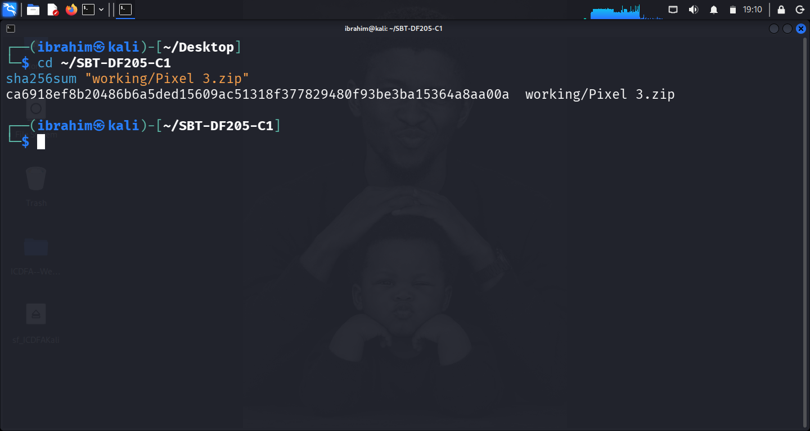
**Figure 1:** `sha256sum` output of the original `Pixel 3.zip` archive.

## 3. Findings

### 3.1 Task 2: Device Identity and Profiles
**Build Properties:** `ro.build.id=QQ1A.200105.003`, `ro.build.version.release=10`.
**User Profiles:** User 0 (Owner) and User 11 (Work Profile).

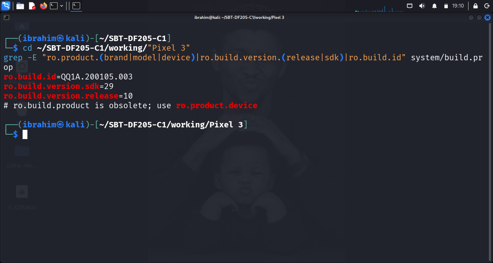
**Figure 2:** `grep` output showing the Android 10 build.

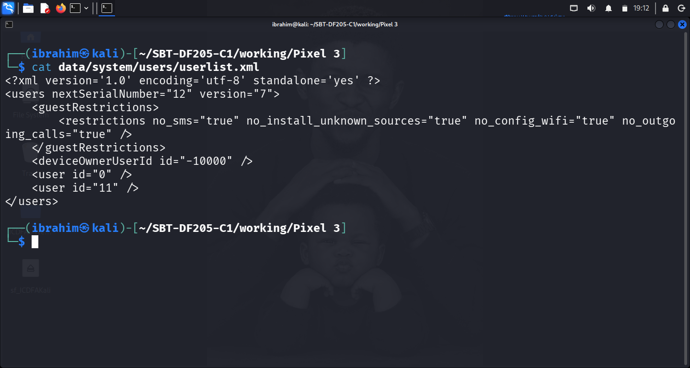
**Figure 3:** `userlist.xml` showing User 0 and User 11.

### 3.2 Task 3: Settings and Connectivity
**Wi-Fi Configuration:** The `<MacAddressMap>` is empty (no saved networks).
**Settings Secure:** `install_non_market_apps=1` (Sideloading is enabled).

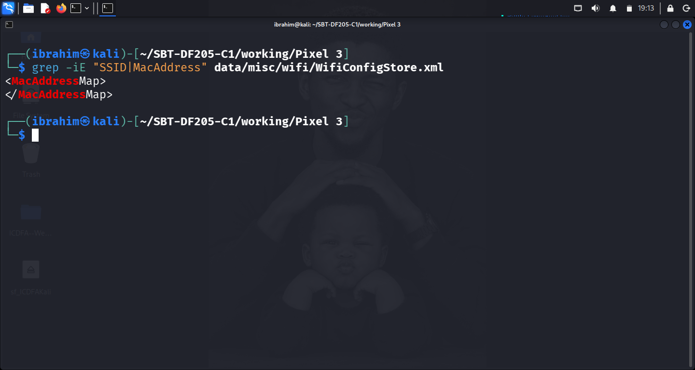
**Figure 4:** `WifiConfigStore.xml` showing empty MacAddressMap.

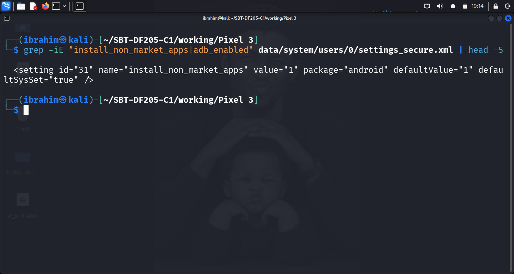
**Figure 5:** `settings_secure.xml` showing sideloading is enabled.

### 3.3 Task 4: AOSP Communications and Contacts
**SMS Records:** Message sent to `919-579-0479` on `1581685743277` (UTC: 2020-02-14 15:49:03).
**Call Logs:** Call to `9195790479` on `1581691278351` lasted 91 seconds.
**Contacts:** Linked `(919) 579-0479` to **Josh Hickman**.

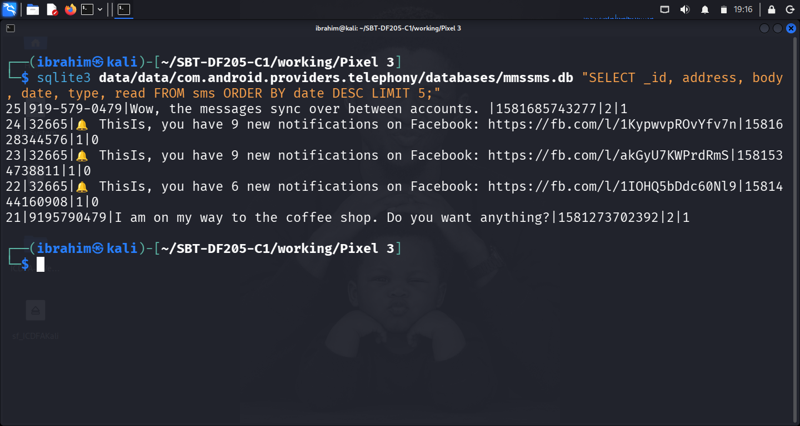
**Figure 6:** SQLite output of `mmssms.db`.

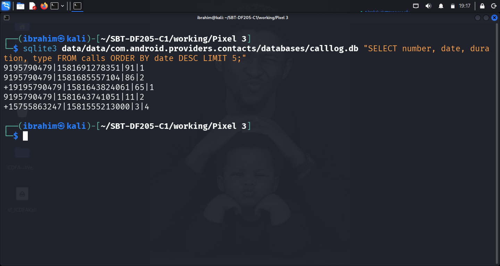
**Figure 7:** SQLite output of `calllog.db`.

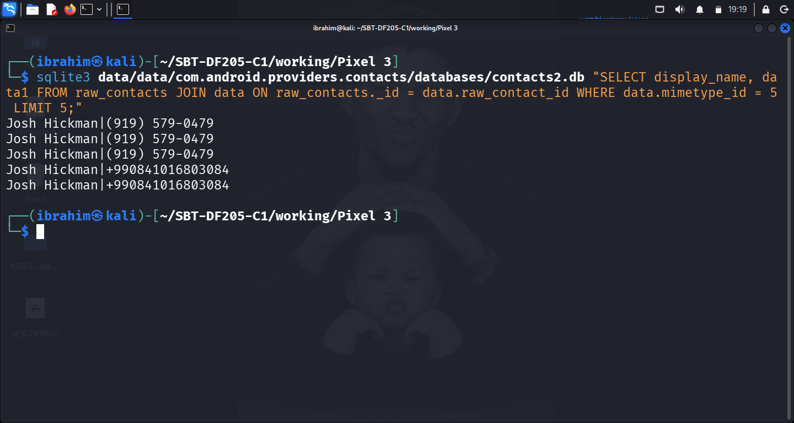
**Figure 8:** SQLite output of `contacts2.db`.

### 3.4 Task 5: Google Messages
The `bugle_db` table links to the Telephony DB via `sms_message_uri` (e.g., `content://sms/24`), proving Google Messages handled the messages.

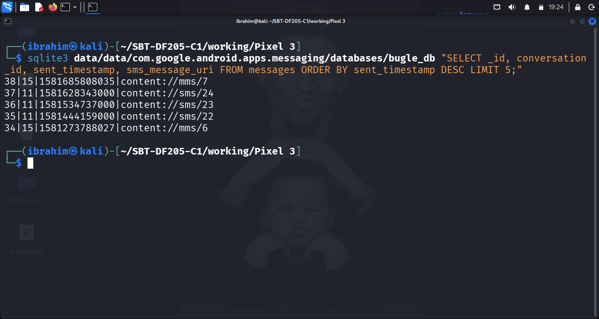
**Figure 9:** SQLite output of `bugle_db` showing `sms_message_uri` links.

### 3.5 Task 6: WhatsApp and TextNow
**WhatsApp:** Only `status@broadcast` rows found. No chat history.
**TextNow:** Conversation with `+1(984) 203-2223` extracted.

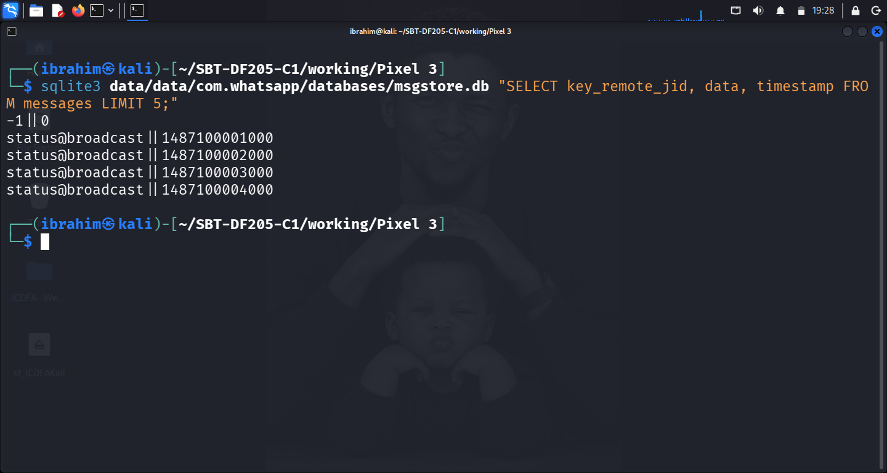
**Figure 10:** SQLite output of `msgstore.db`.

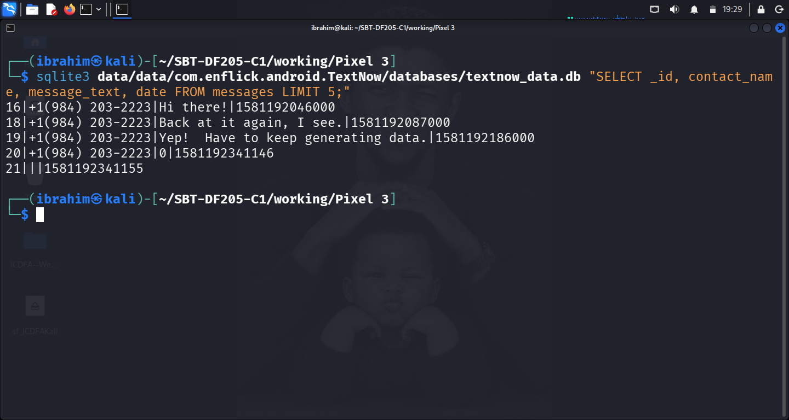
**Figure 11:** SQLite output of `textnow_data.db`.

### 3.6 Task 7: Maps and Photographs
**Maps:** Location `35.734602, -78.636654` (Raleigh, NC) recovered from `sync_item`.
**Photos:** Local media records include `IMG_20190917_082637.jpg`.

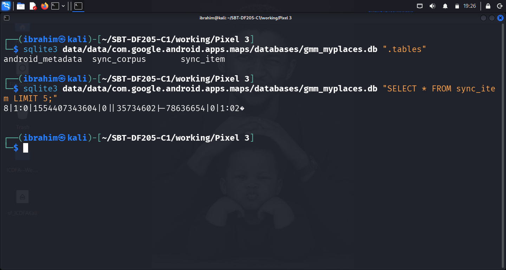
**Figure 12:** SQLite output of Maps DB.

---

## 4. Timeline and Correlation

| UTC Timestamp | Raw Timestamp | Event Description | Source Artefact |
| :--- | :--- | :--- | :--- |
| 2020-02-14 15:49:03 | 1581685743277 | SMS sent to Josh Hickman | `mmssms.db` |
| 2020-02-14 15:49:18 | 1581691278351 | Call to Josh Hickman (91s) | `calllog.db` |
| 2020-02-08 14:54:52 | 1581192046000 | TextNow: "Hi there!" received | `textnow_data.db` |

## 5. Conclusion and Limitations
The device belongs to Josh Hickman and was used for communication. The allegation of unauthorised use requires HR context. Technical evidence proves device activity, not operator identity. WhatsApp history was not present in this backup.
