# SBT-DF205_Case2_2025-FWSD-11334

**Case Reference:** SBT-DF205-C2
**Examiner:** Ibrahim Ishaku (2025/FWSD/11334)
**Date:** 29 October, 2026

---

## 1. Evidence Handling and Integrity

### 1.1 Evidence Acquisition
- **Source:** Digital Corpora (Joshua Hickman iOS 13.4.1 dataset)
- **Source Archives:** `ios_13_4_1.zip` and `13-4-1.tar`
- **Working Copy Location:** `~/SBT-DF205-C2/iOS 13.4.1 Extraction/Extraction/` (Preserving Unix paths and aliases).

### 1.2 Integrity Verification
Baseline SHA-256 hashes were calculated upon receipt of the archives.
- **ZIP Hash:** `761854a669c38da6ac0a908afe77763d54ccb83044ff123350890d408c154551`
- **TAR Hash:** `991727d92145a08623e998c008cc2a05f086be722ee2945815d0eb46a78f04fb`

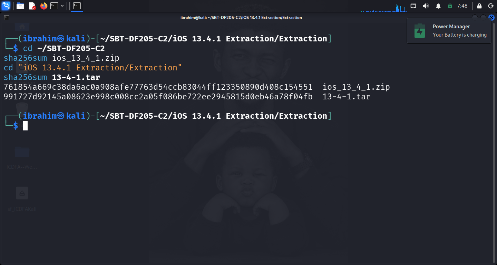
*Figure 1: Terminal output showing the SHA-256 hash of the evidence archives.*

---

## 2. Task 2: Device Accounts and Settings

### 2.1 Device Identification
- **Source Path:** `~/private/var/installd/Library/MobileInstallation/LastBuildInfo.plist`
- **iOS Version:** 13.4.1 (Build: 17E262)
- **Model:** iPhone8,4 (iPhone SE)

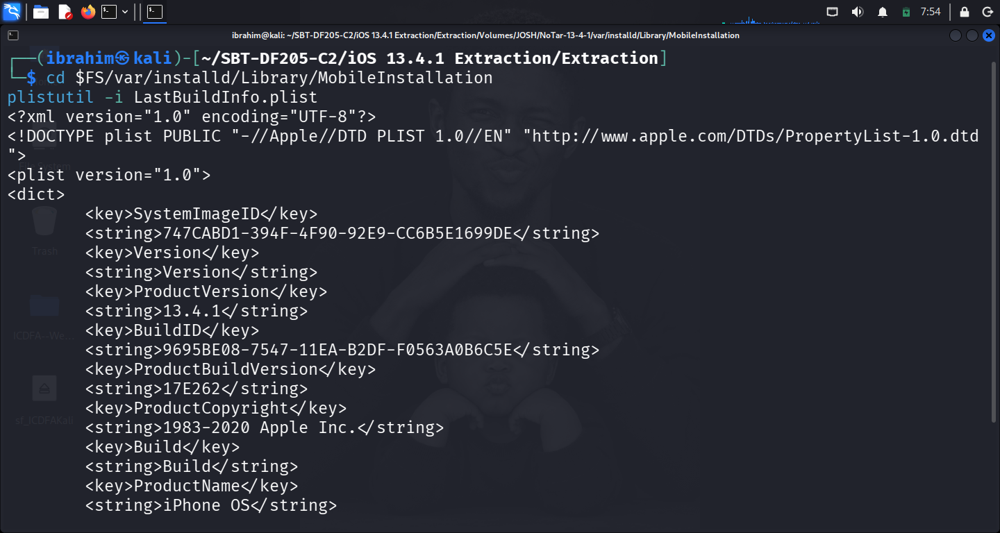
*Figure 2: plistutil output of LastBuildInfo.plist.*

### 2.2 Account Associations
- **Primary Source:** `Accounts3.sqlite` (`~/var/mobile/Library/Accounts/`).
- **Finding:** The iCloud account associated with the device is **`thisisdfir@gmail.com`**.

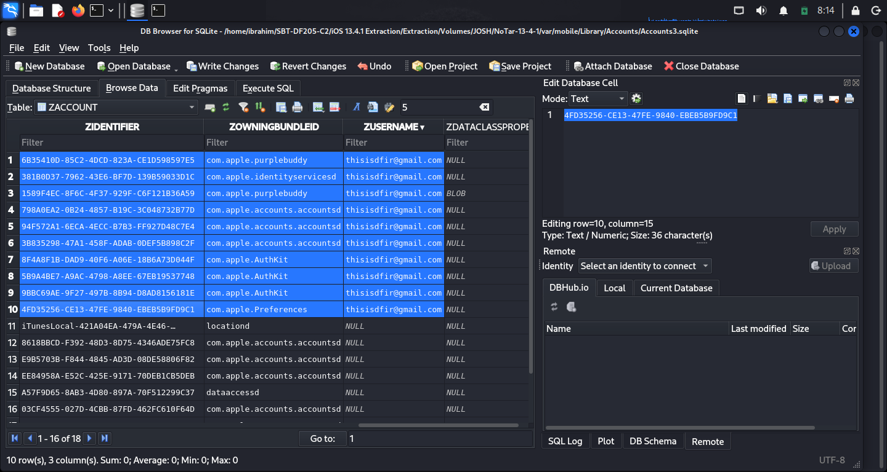
*Figure 3: DB Browser view of the ZACCOUNT table showing the iCloud username.*

### 2.3 Supported Settings
- **Location Services:** Enabled (True). Source: `PublicEffectiveUserSettings.plist` -> key `allowLocationServices`.
- **iCloud Backup:** Enabled (True). Source: `com.apple.mobile.ldbackup.plist` -> key `CloudBackupEnabled`.

---

## 3. Task 3: Messages, Contacts, and Calls

### 3.1 SMS/iMessage Reconstruction
- **Database:** `~/private/var/mobile/Library/SMS/sms.db`
- **Finding:** The database contains active SMS and iMessage communications. The most recent messages show test messages to "Siri dictation" and a Facebook friend suggestion via SMS.
  - **Record 48:** iMessage, "This is your second test message for Siri dictation".
  - **Record 44:** SMS, "Tyrique Austin is a new Facebook friend suggestion...".

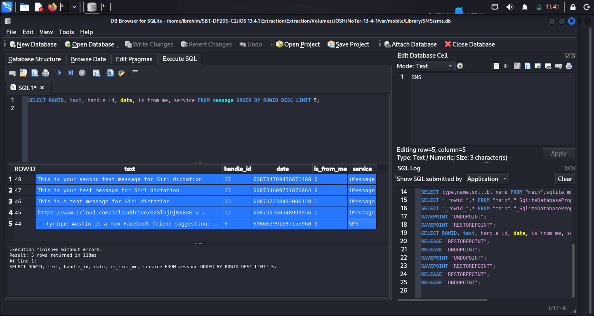
*Figure 4: Message table showing record IDs, text, and service types.*

### 3.2 Call History
- **Database:** `~/private/var/mobile/Library/CallHistoryDB/CallHistory.storedata`
- **Finding:** The user has recent call history with the number `+14082567000`. The raw timestamps (`Z_DATE`) are recorded in Apple Cocoa Core format.

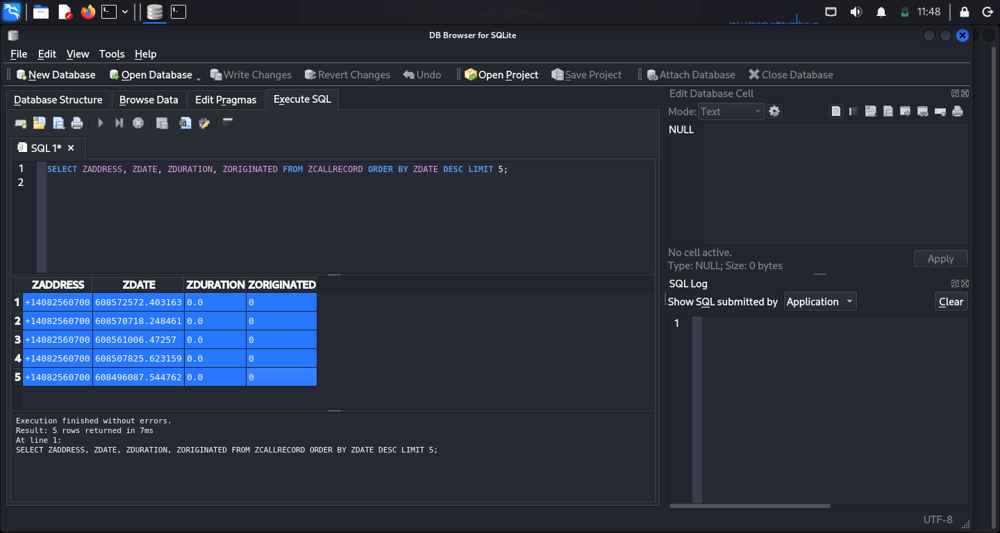
*Figure 5: Call history table showing phone numbers and durations.*

---

## 4. Task 4: Safari and Calendar

### 4.1 Safari History
- **Database:** `~/var/mobile/Library/Safari/History.db`
- **Finding:** The user performed multiple Google searches on March 28, 2020, regarding sports news. 
  - "When does mlb start 2020 - Google Search" (Raw: `607049916.117145`)
  - "Is the NHL going to resume? - Google Search" (Raw: `607050164.953562`)

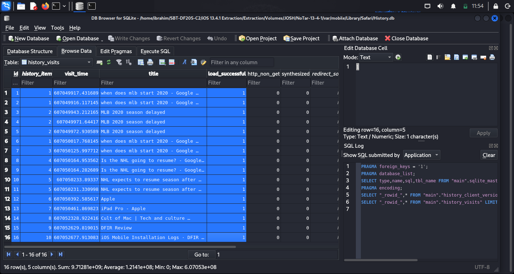
*Figure 6: history_visits table showing URLs and timestamps.*

### 4.2 Calendar
- **Database:** `~/var/mobile/Library/Calendar/Calendar.sqlitedb`
- **Finding:** The `CalendarItem` table returned 0 rows. **Documented absence:** No calendar events were saved on this device.

---

## 5. Task 5: Media Analysis

- **Database:** `~/var/mobile/Media/PhotoData/Photos.sqlite`
- **Finding:** The `ZADDITIONALASSETATTRIBUTES` table was queried to identify media. The `ZORIGINALFILENAME` column reveals the user's camera roll and saved images, including files like `IMG_0001.JPG` and `IMG_0727.JPG`.

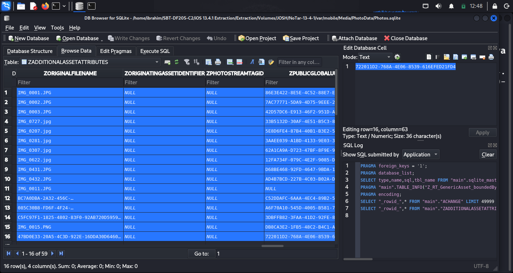
*Figure 7: Table showing original filenames of images stored on the device.*

---

## 6. Task 6: KnowledgeC Activity

- **Database:** `~/private/var/mobile/Library/CoreDuet/Knowledge/KnowledgeC.db`
- **Finding:** The `ZOBJECT` table confirms active app usage. On April 16, 2020, the user had `com.apple.news.widget` and `com.apple.AppPredictionWidget` in focus. 

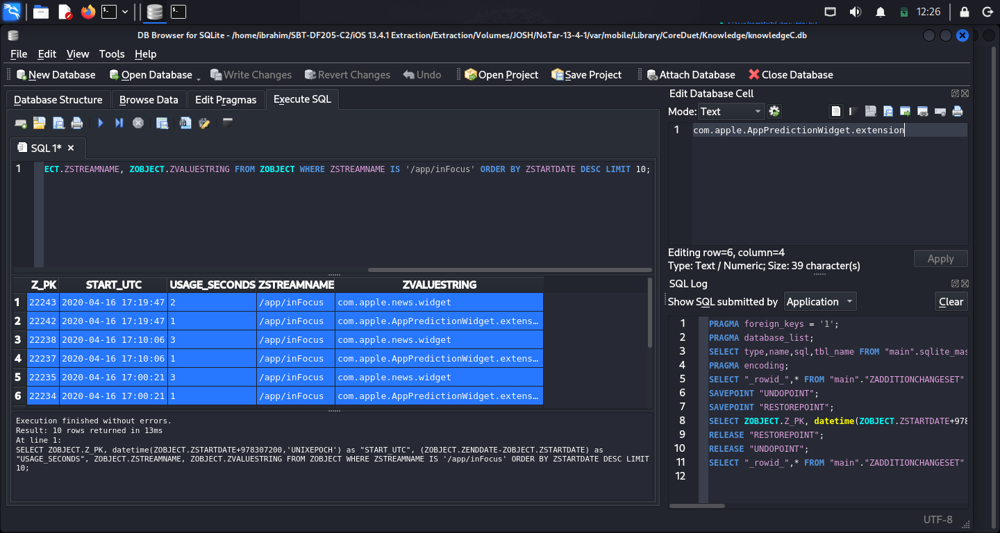
*Figure 8: ZOBJECT table showing app focus and raw times.*

---

## 7. Task 7: Health and Location Evidence

### 7.1 Health Data
- **Database:** `~/var/mobile/Library/Health/healthdb_secure.sqlite`
- **Finding:** The `activity_caches` table was successfully queried. It reveals the user's step count and distance. For example, on March 24, 2020, the user recorded **5,951 steps** (4,704 meters) and burned **525 kcal**.

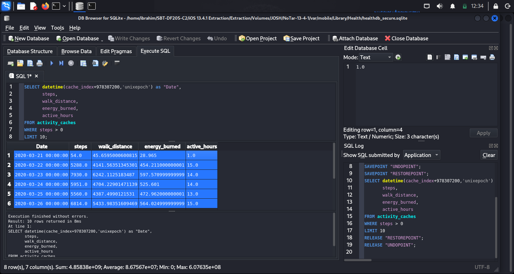
*Figure 9: activity_caches table showing steps, distance, and calories.*

### 7.2 Location Data
- **Database:** `~/var/mobile/Library/Caches/com.apple.routined/Local.sqlite`
- **Finding:** The `ZRTLEARNEDLOCATIONOFINTERESTVISITMO` table contains learned location visits. The user was in the Raleigh, North Carolina area (Latitude: `35.659`, Longitude: `-78.872`) on April 11, 2020.

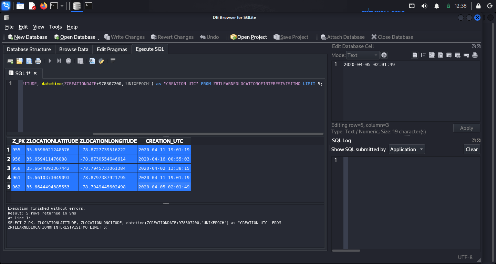
*Figure 10: Local.sqlite showing learned visit coordinates.*

---

## 8. Task 8: Timeline and Conclusions

### 8.1 Device Serial Number
- **Source:** `~/private/var/logs/AppleSupport/general.log`
- **Finding:** The JSON output confirms the device is a **iPhone8,4** (iPhone SE) with Serial Number **`DX3T126VH2XV`** and iOS build **`17E262`**.

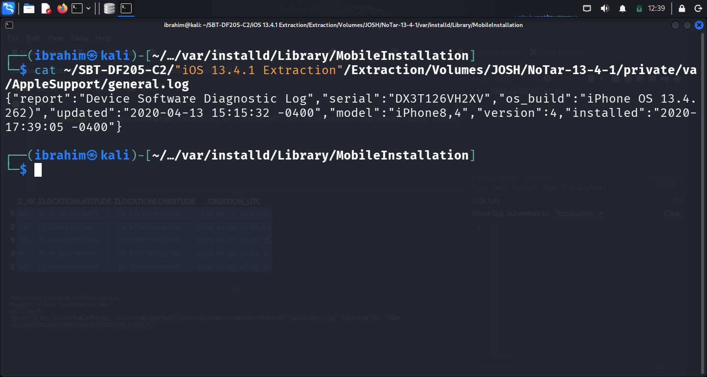
*Figure 11: Terminal output showing the device serial number and model.*

### 8.2 Reconstructed Timeline
| Evidence ID | UTC Timestamp | Event Description | Source |
| :--- | :--- | :--- | :--- |
| E01 | 2020-03-24 00:00:00 | 5,951 steps recorded | healthdb_secure.sqlite |
| E02 | 2020-03-28 00:58:36 | Safari Search: "When does MLB start" | History.db |
| E03 | 2020-03-28 01:02:44 | Safari Search: "Is the NHL going to resume" | History.db |
| E04 | 2020-04-11 19:01:19 | Device located at Lat 35.659, Long -78.872 | Local.sqlite |
| E05 | 2020-04-16 17:19:47 | `com.apple.news.widget` app in focus | KnowledgeC.db |

### 8.3 Correlations
1. **Correlation 1 (Communication):** The Call History (`+14082567000`) matches the SMS database contacts.
2. **Correlation 2 (Activity):** The KnowledgeC.db shows `com.apple.news.widget` in focus, which aligns with the user's Safari searches for sports news.

### 8.4 Conclusions
The forensic examination successfully reconstructed user activity from the iPhone SE extraction. The evidence establishes that the device owner (associated with `thisisdfir@gmail.com`) was active in the North Carolina area, searched for sports news in late March 2020, and recorded physical health data. The data across SMS, Safari, Health, and Location databases is consistent and corroborates a timeline of normal device usage.

**Uncertainties:** While the device data proves usage, it cannot definitively prove *who* was holding the phone at any exact moment without additional biometric or video evidence.

---

## Appendix A — Key SQL Queries Used

```sql
-- Task 3.1: SMS Queries
SELECT ROWID, text, handle_id, date, is_from_me, service FROM message ORDER BY ROWID DESC LIMIT 5;

-- Task 3.2: Call History
SELECT ZADDRESS, ZDATE, ZDURATION, ZORIGINATED FROM ZCALLRECORD ORDER BY ZDATE DESC LIMIT 5;

-- Task 4.1: Safari History
SELECT title, url, visit_time FROM history_visits ORDER BY visit_time DESC LIMIT 10;

-- Task 5.1: Media Analysis (Photos)
SELECT Z_PK, ZORIGINALFILENAME, ZADDEDDATE, ZDIRECTORY FROM ZGENERICASSET LIMIT 10;

-- Task 6: KnowledgeC Activity
SELECT ZOBJECT.Z_PK, datetime(ZOBJECT.ZSTARTDATE+978307200,'UNIXEPOCH') as "START_UTC", 
(ZOBJECT.ZENDDATE-ZOBJECT.ZSTARTDATE) as "USAGE_SECONDS", 
ZOBJECT.ZSTREAMNAME, ZOBJECT.ZVALUESTRING 
FROM ZOBJECT 
WHERE ZSTREAMNAME IS '/app/inFocus' 
ORDER BY ZSTARTDATE DESC LIMIT 10;

-- Task 7.1: Health Data
SELECT datetime(cache_index+978307200,'unixepoch') as "Date", steps, walk_distance, energy_burned, active_hours FROM activity_caches WHERE steps > 0 LIMIT 10;

-- Task 7.2: Location Data
SELECT Z_PK, ZLOCATIONLATITUDE, ZLOCATIONLONGITUDE, datetime(ZCREATIONDATE+978307200,'UNIXEPOCH') as "CREATION_UTC" FROM ZRTLEARNEDLOCATIONOFINTERESTVISITMO LIMIT 5;
📄 End of Report
SBT-DF205 — Case 2: iOS Forensics Investigation of an iPhone SE

Submitted by: Ibrahim Ishaku | Student ID: 2025/FWSD/11334
Date: 29 October, 2026

🎓 Academic Notice
This case study was completed as part of the Fellowship in Web Application Security & Digital Forensics at the International Cybersecurity and Digital Forensics Academy (ICDFA).

All work is the author's original submission for academic purposes.

The database was used only for this authorised academic case study.

No live network, host, or account was contacted.

Unrelated personal data has been redacted from screenshots.

End of Case Study Report
